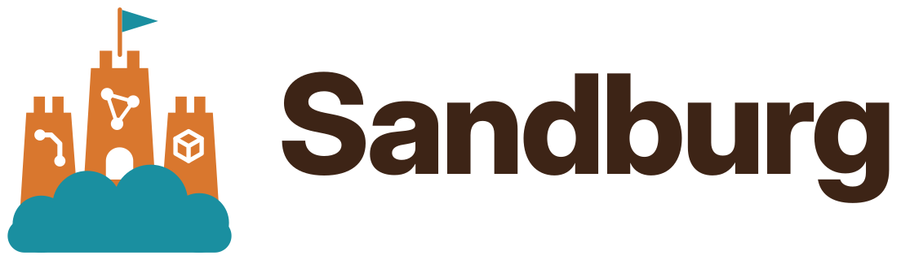

<p align="center">
  <picture>
    <source media="(prefers-color-scheme: dark)" srcset="assets/logo-dark.svg">
    
  </picture>
</p>

**A workshop in the cloud for Claude Code.** Sandburg is a Docker image with Blender, FreeCAD, KiCad, build123d, Inkscape, ComfyUI, a browser and optional speech output, each with a ready-to-use MCP server. You start it on a GPU cloud such as RunPod, it joins your tailnet, and your local Claude Code works with it as if the programs were installed on your machine. A Claude Code plugin wires everything up with a single command, and Claude downloads finished files to you on its own.

```
  Your machine                          GPU pod (this image)
 ┌───────────────────────┐  Tailscale  ┌───────────────────────────────────────────────┐
 │ Claude Code           │ ──────────▶ │ mcp-proxy :9090 (token)                       │
 │  + plugin "sandburg"  │             │   /blender    ─▶ Blender (GUI on Xvfb)        │
 │    (MCP, skill,       │             │   /freecad    ─▶ FreeCAD (GUI on Xvfb)        │
 │     sandburg command) │             │   /kicad      ─▶ kicad-cli + pcbnew           │
 └───────────────────────┘             │   /build123d  ─▶ build123d (CAD as code)      │
                                       │   /inkscape   ─▶ Inkscape + potrace           │
 Browser ── :6080 desktop (noVNC) ───▶ │   /comfyui    ─▶ ComfyUI (optional 3D)        │
 Browser ── :8188 ComfyUI ───────────▶ │   /browser    ─▶ Chromium (Playwright)        │
 Finder/curl ── :8090 files ─────────▶ │   /voice      ─▶ Kokoro + Whisper (optional)  │
                                       │ dufs: /workspace/projects (HTTP + WebDAV)     │
                                       └───────────────────────────────────────────────┘
```

## What's inside

| Service | What it does | MCP server | Default |
|---|---|---|---|
| **Blender** 5.2.3 LTS | 3D models, scenes, renders (Cycles on the GPU), animation | [mcp-for-blender](https://github.com/ahujasid/mcp-for-blender) 2.2.4 | on |
| **FreeCAD** 1.1.4 | Parametric CAD, assemblies, FEM, STEP/STL | [neka-nat/freecad-mcp](https://github.com/neka-nat/freecad-mcp) | on |
| **KiCad** 10 | Schematics, PCBs, ERC/DRC, Gerber, bills of materials | [Seeed-Studio/kicad-mcp-server](https://github.com/Seeed-Studio/kicad-mcp-server) | on |
| **build123d** | CAD as Python code: reproducible, preview images, STEP/STL/DXF | [build123d-mcp](https://github.com/pzfreo/build123d-mcp) 0.3.91 | on |
| **Inkscape** (current stable release) | Check and view SVGs, convert text to paths, export to DXF/PDF/PNG, vectorize images | custom server (`servers/inkscape-mcp`) | on |
| **Browser** (Chromium) | Operate websites, download files straight to the pod, view your own HTML output | [Playwright MCP](https://github.com/microsoft/playwright-mcp) 0.0.83 | on |
| **ComfyUI** | Generate images; with `ENABLE_COMFYUI_3D=1` also image-to-3D (Hunyuan3D 2.1) | [comfy-mcp](https://github.com/Comfy-Org/comfy-mcp) 0.10.0 (official) | on, 3D off |
| **Voice** | Speech output (English, Spanish, French, Hindi, Italian, Portuguese, Chinese), transcription and subtitles | custom server (`servers/voice-mcp`) with [Kokoro-82M](https://huggingface.co/hexgrad/Kokoro-82M) and Whisper | off |

Blender, FreeCAD and the browser run visibly on a virtual desktop. You can watch them in your browser via noVNC and step in when needed. A disabled service stays visible in the plugin and tells Claude how to enable it.

## 1. Build the image

**Locally:**

```bash
docker login ghcr.io -u <user>    # password: a GitHub token with the write:packages scope
docker build -t ghcr.io/<user>/sandburg:latest .
docker push ghcr.io/<user>/sandburg:latest
```

**Via GitHub Actions:** The workflow in `.github/workflows/build.yml` only builds when you start it manually (*Actions* → *Build image* → *Run workflow*) or when the last commit of a push to `main` contains `[build]` in its message. It publishes the image as `ghcr.io/<user>/<repo>:latest`.

After the first push, set the visibility to *public* in the package settings on GitHub so RunPod can pull the image.

The image is large (roughly 18 GB, mostly PyTorch, FreeCAD and Chromium). `--build-arg KICAD_3D_MODELS=true` adds the KiCad 3D models. All versions are defined as `ARG`s at the top of the `Dockerfile`.

## 2. Create a Tailscale auth key

Create a key at <https://login.tailscale.com/admin/settings/keys>:

- **Reusable**, so every new pod can join.
- **Ephemeral**, so terminated pods disappear from the tailnet automatically.
- Optionally a **tag** such as `tag:sandburg`, to restrict access to your devices via ACL.

Tailscale runs in userspace mode and needs neither `/dev/net/tun` nor extra privileges.

## 3. RunPod template

| Field | Value |
|---|---|
| Container Image | `ghcr.io/<user>/sandburg:latest` |
| Container Disk | 50 GB |
| Volume Disk | 50 GB or more (ComfyUI and speech models), mount path `/workspace` |
| Expose HTTP/TCP Ports | **none**, everything goes through Tailscale |
| Environment Variables | `TS_AUTHKEY` (ideally as a RunPod secret); optional `SANDBURG_TOKEN`, `TS_HOSTNAME`, `ENABLE_VOICE=1`, `ENABLE_COMFYUI_3D=1` |

After the first start the token is stored in `/workspace/.sandburg-token`, unless you set `SANDBURG_TOKEN` yourself. With a volume, the token, Tailscale identity, browser profile, projects and models persist across restarts.

## 4. Connect Claude Code

On your machine (which must be in the same tailnet):

```bash
claude plugin marketplace add trn84/sandburg
claude plugin install sandburg@sandburg
```

Or in a running session: `/plugin marketplace add trn84/sandburg`, then `/plugin install sandburg@sandburg`.

Then set the address (default `sandburg`, i.e. the Tailscale name) and the token (`cat /workspace/.sandburg-token` on the pod) in a Claude Code session with `/plugin configure sandburg@sandburg`. The token is stored in the system keychain. After that, all services are connected. The plugin also ships a skill that explains the folders and workflows on the Sandburg to Claude, and the `sandburg` command for file transfer. Address and token can be changed later under `/plugin` → **Installed** → *sandburg* → **Configure options**.

It also works without the plugin: copy `client/mcp.json.example` into your project as `.mcp.json` and set `SANDBURG_TOKEN` in your shell.

Without MagicDNS, enter the pod's 100.x IP instead of `sandburg` (`tailscale status`). If an old pod with the same name is still in the tailnet, Tailscale assigns `sandburg-1`. Ephemeral keys avoid this.

**Other interfaces in the tailnet:**

- Desktop with Blender, FreeCAD and browser: `http://sandburg:6080/vnc.html` (password in `/workspace/.vnc-password`)
- ComfyUI: `http://sandburg:8188`

## 5. Exchange files

A small file server ([dufs](https://github.com/sigoden/dufs)) serves everything under `/workspace/projects` at `http://sandburg:8090`. Login: user `sandburg`, the password is the token.

**With the plugin, Claude does this itself.** Given a request like "Design an enclosure for me and put the STL in my project folder", Claude models on the pod, exports to `/workspace/projects/…` and downloads the file with the `sandburg` command. It uploads local files beforehand. You can use the command yourself, too:

```bash
sandburg status                      # reachable? which services?
sandburg ls freecad                  # list a folder
sandburg get freecad/enclosure.stl   # download (folders arrive as .zip)
sandburg put drawing.step freecad/   # upload
```

Also:

- **In the browser:** `http://sandburg:8090` with a file list, drag-and-drop upload and folders as zip.
- **As a network drive (WebDAV):**
  - macOS: Finder → *Go* → *Connect to Server* → `http://sandburg:8090`
  - Windows: Explorer → *Map network drive*
  - Linux: `dav://sandburg:8090`

| Folder on the Sandburg | Contents |
|---|---|
| `projects/blender`, `freecad`, `kicad`, `build123d`, `inkscape` | Working directories of the respective services |
| `projects/comfyui/input`, `projects/comfyui/output` | ComfyUI inputs and results (3D models under `output/mesh`) |
| `projects/browser` | Browser downloads and screenshots |
| `projects/audio` | Speech output, `transcripts/` |
| `comfyui/models` | ComfyUI models (not exposed via the file server) |
| `.sandburg/` | Browser profile and speech model environment |

## Optional services

**Voice (`ENABLE_VOICE=1`):** On first start, a separate Python environment for the speech models is set up on the volume. This takes a few minutes (log: `/var/log/sandburg/voice-setup.log`). The first speech call downloads the models. After that they stay in GPU memory and are unloaded again after 10 minutes without a call (`VOICE_IDLE_MINUTES`), so ComfyUI and Blender get the memory back.

- `speak`: text of any length to WAV or MP3, with one of Kokoro's voices (`list_voices`).
- `transcribe`: audio or video to text in any language Whisper knows, optionally as SRT subtitles.

**ComfyUI 3D (`ENABLE_COMFYUI_3D=1`):** Downloads the Hunyuan3D 2.1 model (about 7.4 GB) to the volume once. ComfyUI supports it without extensions. The `3d_hunyuan3d-v2.1` template turns an image into an untextured 3D model (GLB) that you can refine in Blender.

## Configuration (environment variables)

| Variable | Default | Meaning |
|---|---|---|
| `TS_AUTHKEY` | – | Tailscale auth key; empty = Tailscale off |
| `TS_HOSTNAME` | `sandburg` | Name in the tailnet |
| `TS_EXTRA_ARGS` | – | Extra arguments for `tailscale up`, e.g. `--ssh` |
| `SANDBURG_TOKEN` | generated | Token for the MCP proxy and file server. At least 16 characters, only `A-Z a-z 0-9 . _ ~ -` |
| `VNC_PASSWORD` | generated | Password for the desktop |
| `ENABLE_BLENDER`, `_FREECAD`, `_KICAD`, `_BUILD123D`, `_INKSCAPE`, `_BROWSER`, `_COMFYUI`, `_VNC`, `_FILES` | `1` | Disable individual services (`0`) |
| `ENABLE_VOICE`, `ENABLE_COMFYUI_3D` | `0` | Enable optional services (`1`) |
| `VOICE_IDLE_MINUTES` | `10` | Unload speech models after this many minutes without a call (`0` = never) |
| `BROWSER_VIEWPORT` | `1440x900` | Browser window size |
| `BROWSER_MCP_ARGS` | – | Extra arguments for Playwright MCP, e.g. `--blocked-origins` |
| `BIND_ADDR` | `127.0.0.1` | Listen address for the MCP proxy and file server (both token-protected). `0.0.0.0` only without Tailscale |
| `UI_BIND_ADDR` | `127.0.0.1` | Listen address for noVNC and ComfyUI. ComfyUI has no authentication, so only change this for local `docker compose` |
| `COMFYUI_ARGS`, `BLENDER_ARGS`, `FREECAD_ARGS` | – | Extra startup arguments |
| `BLENDER_MCP_SAFE_MODE` | `0` | `1` = check Blender scripts before execution |
| `XVFB_RESOLUTION` | `1920x1080x24` | Resolution of the virtual desktop |

## Security

- **Python execution:** Several services run arbitrary Python code (`execute_blender_code`, `execute_code` in FreeCAD, build123d). Anyone who can reach the proxy and has the token effectively has a shell on the pod.
- **The tailnet is the security boundary.** In userspace mode, Tailscale forwards all locally listening ports into the tailnet, including the internal bridges of Blender (9876) and FreeCAD (9875), which have no authentication of their own. Restrict access to the pod to your own devices with a [Tailscale ACL](https://tailscale.com/kb/1018/acls).
- **Browser and third-party websites:** Third-party pages may try to slip instructions to Claude (prompt injection), and the same session has tools that execute code. The pod is an isolated, disposable environment, but still: don't store important logins (Google, banking, company accounts) in the pod's browser.
- **Don't expose ports in RunPod.** As an exception, without Tailscale: `BIND_ADDR=0.0.0.0`, expose only ports 9090 and 8090, and use a long `SANDBURG_TOKEN`. noVNC and ComfyUI stay bound to `127.0.0.1` (`UI_BIND_ADDR`) and are not reachable from outside in this mode, even if their ports are exposed.
- **Token on your machine:** The plugin also stores the token in `~/.config/sandburg/config` (readable only by you) so the `sandburg` command can use it.

## Troubleshooting

Inside the container (RunPod web terminal, or `tailscale ssh` with `TS_EXTRA_ARGS=--ssh`):

```bash
sandburg-status                         # processes, ports, proxy status, Tailscale, GPU
tail -f /var/log/sandburg/blender.log   # or freecad.log, comfyui.log, voice-setup.log
supervisorctl -c /opt/sandburg/supervisord.conf restart blender
```

Locally: `sandburg status` checks whether the pod is reachable and the token is correct.

- **Blender tools don't respond:** Check that port 9876 is listening. On the desktop, press `N` in Blender, open the *MCP for Blender* tab and click *Start MCP Server* if needed.
- **FreeCAD tools don't respond:** Check that port 9875 is listening. On the desktop, open the *MCP Addon* workbench and click *Start RPC Server*. Close any first-run dialog that may be open.
- **Voice doesn't respond:** Setup is still running or has failed, see `voice-setup.log`. The proxy retries the connection every 15 seconds.
- **Browser doesn't start:** A crashed browser sometimes leaves a profile lock behind. It is cleaned up on the next start. If all else fails, delete `/workspace/.sandburg/browser-profile`.
- **Without a GPU:** ComfyUI runs with `--cpu`, Cycles on the CPU, Voice much slower. The GUIs use Mesa on the CPU anyway, which is normal under Xvfb.

## Repository layout

| Path | Contents |
|---|---|
| `Dockerfile`, `rootfs/` | Image, startup scripts, supervisord and proxy configuration |
| `servers/` | Custom MCP servers: Inkscape, Voice, placeholder for disabled services |
| `plugin/`, `.claude-plugin/marketplace.json` | Claude Code plugin and its catalog |
| `client/mcp.json.example` | Manual setup without the plugin |
| `.github/workflows/build.yml` | Image build to GHCR |

**Adding a service:**

1. Install it in the `Dockerfile`.
2. Add it under `mcpServers` in `rootfs/opt/sandburg/mcp-proxy.template.json`. The key becomes the path `/<name>/mcp`.
3. Add an `ENABLE_…` switch in `rootfs/opt/sandburg/bin/entrypoint.sh`.
4. Add it to the plugin (`plugin/.claude-plugin/plugin.json`).

If the service depends on a GUI application, also add a startup script and a `[program:…]` block in `supervisord.conf`.

## Testing locally

```bash
cp .env.example .env      # leave TS_AUTHKEY empty to run without Tailscale
docker compose up --build
# MCP:     http://localhost:9090/<service>/mcp   (token: workspace/.sandburg-token)
# Files:   http://localhost:8090                 (user sandburg, password = token)
# Desktop: http://localhost:6080/vnc.html
```

For the plugin, use `localhost` as the address in that case.

## Licenses

The scripts, custom servers and the plugin in this repository are licensed under MIT. The image contains programs with their own licenses, including:

- Blender, KiCad and ComfyUI under the GPL
- FreeCAD under the LGPL
- Inkscape under the GPL
- comfy-mcp under the AGPL-3.0
- Kokoro under Apache 2.0
- Chromium under BSD licenses
- the NVIDIA CUDA base under NVIDIA's license terms

The sources of each project are linked in the table above.
